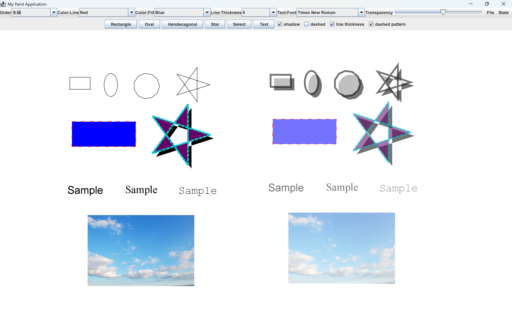

# Java Drawing Tool

Javaを用いて個人制作した簡易ドローツールです。

## 実行環境

- Windows 11で確認

## 実行方法

JDKをインストール後、リポジトリのルートで次のコマンドを実行します。

```powershell
New-Item -ItemType Directory -Force out
javac -encoding UTF-8 -sourcepath src -d out src\gui\Main\MyApplication.java
java -cp out gui.Main.MyApplication
```

## ディレクトリ構成

```text
.
├─ docs/
│  └─ screenshot.png
├─ src/
│  └─ gui/
│     ├─ Button/
│     ├─ Main/
│     └─ Shapes/
├─ .gitignore
└─ README.md
```

## 主な機能

- 長方形・楕円・十一角形・星形・テキストの描画
- 線色・塗りつぶし色・線幅・破線・影・透明度の変更
- 図形の選択・移動・リサイズ・重なり順の変更
- 複数図形の選択
- 画像の挿入
- 作成内容の保存と再読み込み
- ショートカットキー(コピー・切り取り・貼り付け・削除)



## 基本的な使い方

### 描画

- `Rectangle`、`Oval`、`Hendecagonal`、`Star`のいずれかを選択し、描画エリア上でドラッグすると図形を描画できます。
- `Text`を選択して描画エリアをクリックすると、テキスト入力画面が開きます。文字を入力して`Enter`を押すと描画されます。
- 描画前に`shadow`、`dashed`、`line thickness`、`dashed pattern`を選択すると、それぞれ影、破線、太線、細かい破線を適用した図形を描画できます。複数の設定を組み合わせることも可能です。

### 選択・移動・リサイズ

最初に`Select`を押し、選択モードへ切り替えます。

- 図形をクリックすると単一選択できます。描画エリア上をドラッグすると、範囲内の図形を複数選択できます。
- 選択した図形をドラッグすると、選択中のすべての図形をまとめて移動できます。
- 図形を単一選択した状態で、選択枠上の黒い四角形をドラッグするとリサイズできます。

### 選択した図形の変更

最初に`Select`を押し、変更する図形を選択します。

- `Order`で単一図形の重なり順を変更できます。
- `Color:Line`で線の色、`Color:Fill`で塗りつぶしの色を変更できます。`Other Colors`を選択すると、カラーパレットから任意の色を指定できます。
- `Line:Thickness`で線の太さを変更できます。
- テキストを選択している場合は、`Text:Font`でフォントを変更できます。
- `Transparency`スライダーで、選択中の図形の透明度を変更できます。
- `State`メニューの`Shadow`を選択すると、選択中の図形の影を追加または削除できます。

### 保存・読み込み・画像の挿入

- `File`メニューの`Save`で、現在の描画内容をファイルへ保存できます。
- `File`メニューの`Load`で、保存した描画内容を読み込めます。
- `File`メニューの`Image`で画像を挿入できます。`.jpg`と`.png`で動作を確認しており、挿入後はほかの図形と同様に選択・移動・リサイズなどを行えます。

### ショートカット操作

`Select`で選択モードに切り替え、図形を選択してから操作します。

- `C`: コピー
- `X`: カット
- `Delete`: 削除
- コピーまたはカット後に右クリック: 貼り付け

